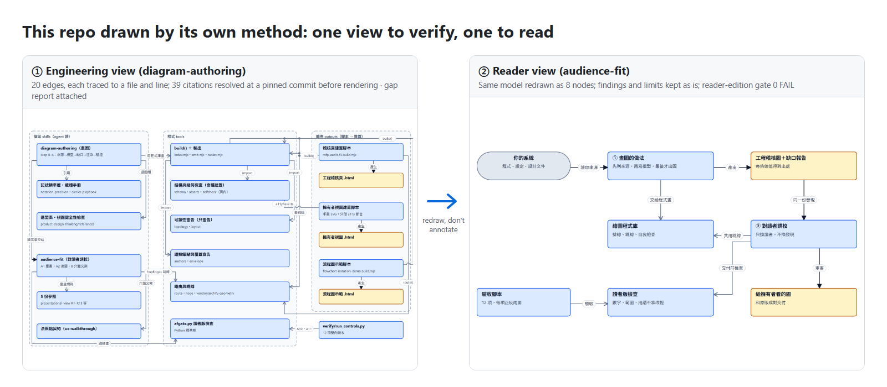
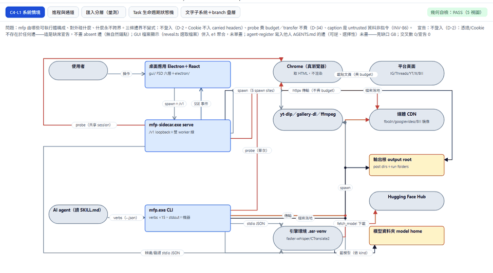
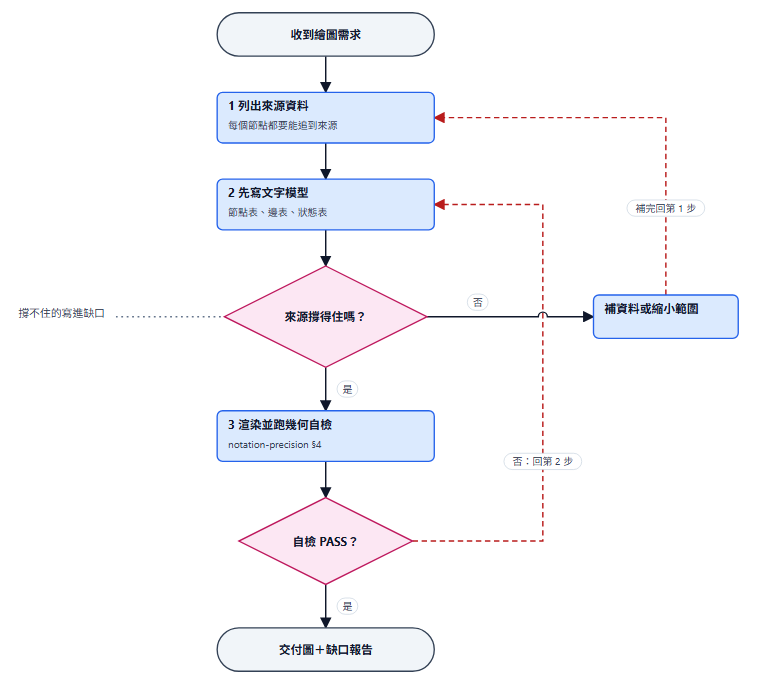
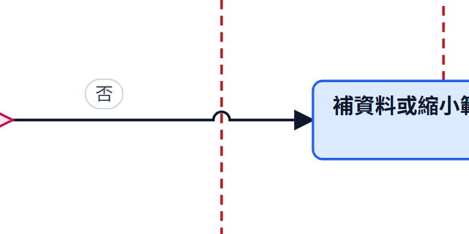
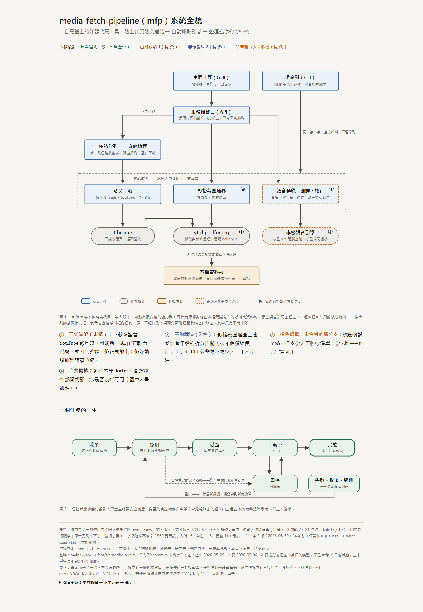
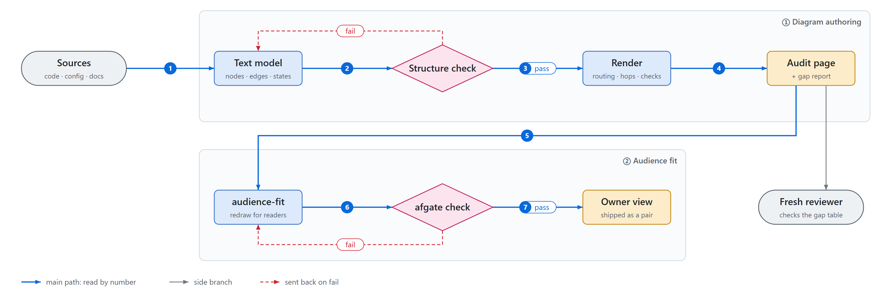
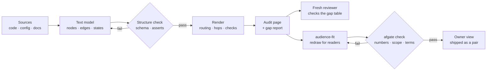

<div align="center">

# diagram-audience-fit

**Make an AI agent draw architecture diagrams where every line traces to a source — then redraw the same findings for people who didn't build the system.**

Two Claude Code skills + a zero-install Node diagram library + a Python gate + real worked examples and acceptance scripts.

[繁體中文](README.md) · **English**

[](https://github.com/WizerdBaChe/diagram-audience-fit/releases/latest)
[](LICENSE)
[](LICENSE-DOCS)
[](AGENTS.md)
[](docs/DEVELOPER.md)
[](docs/DEVELOPER.md)
[](docs/DEVELOPER.md)

[Examples](#at-a-glance) · [Quick start](#quick-start-hand-it-to-your-agent) · [How it works](#how-it-works) · [Developer guide (zh-TW)](docs/DEVELOPER.md) · [Agent entry](AGENTS.md) · [Changelog](CHANGELOG.md)



<sub>The image above is produced by this repository itself: a probe reads the references between files → engineering view (every citation resolved at the pinned commit, tag v1.0.0; the drawing shows the v1.0.0 file structure) → reader view (reader-edition gate 0 FAIL, run recorded in <code>afgate_run.txt</code>). Labels inside the diagrams are Traditional Chinese. Both pages and their build scripts: <a href="docs/self-portrait/"><code>docs/self-portrait/</code></a>.</sub>

</div>

## What it solves

Ask an AI to draw your system's architecture and you usually get one of two things: **a pretty diagram whose lines are guessed**, or an accurate one **only its author can read**.

This repository connects both ends:

| | What you get | How it is kept honest |
|---|---|---|
| **① Diagram authoring** | architecture, state machine, flowchart and audit view sets | every node and edge traces to a listed source or carries `[assumed]`; a text model comes before the picture; the page carries its own geometry self-check; a **gap report** (what the data cannot answer) always ships |
| **② Audience fit** | editions for owners, managers, non-engineers | change the reader, never the findings: numbers, causal strength, scope and limits are never softened; the rewrite ships paired with the original |

## At a glance

<table>
<tr>
<td width="50%" valign="top">

**Five views of one audit**<br>
<sub>context, processes and channels, import layers, state machine, branch overlay; geometry self-check top right</sub>



</td>
<td width="50%" valign="top">

**Flowchart notation**<br>
<sub>terminals, decision diamonds, return edges, side notes; edges leave a diamond from its vertices</sub>



</td>
</tr>
<tr>
<td valign="top">

**Line hops**<br>
<sub>lines that merely pass each other hop with a small semicircle; only real joins get a dot — by default no "+" that looks like a join (old pages can pin the plain style; a bare "+" raises a warning)</sub>



</td>
<td valign="top">

**Redrawn owner view**<br>
<sub>no annotations bolted onto the engineering diagram: a redraw with a few readable nodes, numbered back to the original's findings</sub>

<a href="docs/assets/owner-view.png"></a>

</td>
</tr>
</table>

<sub>The example is a real audit of a media downloader from the author's environment, so labels inside the figures are in Chinese; what transfers is the method. Source pages: [`reference-impl/outputs/diagram-authoring/`](reference-impl/outputs/diagram-authoring/) — open them in any browser.</sub>

## Quick start: hand it to your agent

1. Download the zip from [Releases](https://github.com/WizerdBaChe/diagram-audience-fit/releases/latest), or `git clone` and check out a version tag (pin a tag, not `main`).
2. Give the whole folder to your agent (Claude Code, Codex, Cursor — anything that reads files and runs commands) with:

```text
Read AGENTS.md first and follow its reading order through docs/BUILD-SPEC.md and docs/EVIDENCE.md; reference-impl/ holds working originals to learn from, not to paste wholesale.
From the repo root run python -X utf8 verify/run_controls.py reference-impl <a-new-folder-that-does-not-exist> (it copies, mutates and deletes that folder, so never point it at an existing one) and compare the output with verify/controls_run.txt; sha256 values and counts must match and every control line must end in ok (route-stats timings differ per run).
Then read spec §8 and list which paths and tools map to what in my environment; wait for my confirmation before adapting.
Then draw my first audit diagram per spec §2: list sources (step 0), write the text model, open the gap report, render last; have a subagent that did not draw it review the gap table.
```

3. Needs Node 24, Python 3.12 and `git` (only these versions were run; no `npm install`, the gate is stdlib-only).

## How it works



1. **Sources → Text model**: code, config and design docs are written down as node, edge and state tables first.
2. **Text model → Structure check**: schema and asserts check the model; on fail it goes back to the Text model.
3. **Structure check → Render**: only a passing model is drawn — routing, line hops, an in-page geometry self-check.
4. **Render → Audit page**: the audit page ships with its gap report; the gap table goes to a Fresh reviewer, a clean context that did not draw it.
5. **Audit page → audience-fit**: the same findings are redrawn for readers.
6. **audience-fit → afgate check**: numbers, scope and terms are checked; on fail it goes back to be redrawn.
7. **afgate check → Owner view**: on pass it ships paired with the original.

<sub>Drawn by <a href="docs/assets/pipeline.build.mjs"><code>docs/assets/pipeline.build.mjs</code></a> (<code>--lang en</code>); the model asserts and the in-browser text-fit check each ship with known-bad controls.</sub>

<details><summary>Text edition (mermaid)</summary>



</details>

Four principles run through everything: **a diagram without a model is a screenshot** (build scripts ship with the figures) · **structure and geometry are machine-checked, appearance is human-checked** · **a check rules only on what it can determine** · **a reader edition changes the reader, never the findings**.

## Documentation map

| You want to… | Read | Language |
|---|---|---|
| know what it does | this page | English / [中文](README.md) |
| structure tree, pipeline, design choices, limits, manual acceptance | [`docs/DEVELOPER.md`](docs/DEVELOPER.md) | zh-TW |
| have an agent build it | [`AGENTS.md`](AGENTS.md) → [`docs/BUILD-SPEC.md`](docs/BUILD-SPEC.md) | English |
| see what was measured and what is not claimed | [`docs/EVIDENCE.md`](docs/EVIDENCE.md) | English |
| a machine-readable index (llms.txt) | [`llms.txt`](llms.txt) | English |

## This release

**v1.2.0 (2026-11-07)**: line clearance becomes one shared module: a line through a foreign group box, over a title, hugging a node, crowding another line or turning back on its own endpoints raises a warning (WARN only, never a build stop), and the check also runs standalone on a page. The router now defaults to revision 3, which avoids these while placing lines. Audit pages record which standard view set they were checked against and warn once the set moves on. Audit builds read the audited sources frozen at a commit, never the live working tree. Example page bytes unchanged; new machine control A17, all 13 pass.

**v1.1.0 (2026-11-05)**: reader diagrams gain a default visual vocabulary, rule R14: one accent path numbered with a step list under the figure; at most four edge kinds, told apart by colour and line style; name and role in two text sizes; at least one node width between nodes. Nothing that encodes no meaning is added, and no icons or logos (R7). The "How it works" figure above is the first one drawn under R14, with its build script and two-sided checks. Example page bytes unchanged; all 12 machine controls pass.

**v1.0.2 (2026-11-01)**: correctness fixes in both checkers (numbers glued to Chinese text were missed, plain long numbers were taken for hashes, malformed models crashed the build), each with self-test cases; `docs/EVIDENCE.md` gains an enforcement map (which rules code enforces, which are process only), `AGENTS.md` opens with facts, `llms.txt` gains a read-only route. Example page bytes unchanged.

**v1.0.1 (2026-11-01)**: a self-portrait (this repo drawn by its own method, engineering + reader view) as the hero; rewritten overview, English page, developer guide, llms.txt. The capability itself (skills, library, gate, original examples) is unchanged.

**v1.0.0 (2026-11-01)**: flowchart notation, line hops by default, a flowchart added to the audit's standard view set, presentational-view rule R13 (a crossing never reads as a join); all 12 machine controls pass. Full notes: [`CHANGELOG.md`](CHANGELOG.md).

## Limits (summary)

Run only on Windows 11 + Node 24.22 + Python 3.12. This release did not re-run the in-page geometry check in a browser, and appearance was not re-confirmed by a person. The full limits list and the manual acceptance checklist are in [`docs/DEVELOPER.md`](docs/DEVELOPER.md#範圍與限制) (Traditional Chinese) and spec §8; what this release did not claim is in [`docs/EVIDENCE.md`](docs/EVIDENCE.md).

Not every method rule above is enforced by code. Code enforces that a source is filled in, the geometry, and that a reader edition invents no number (a screen over numbers with 3+ significant digits); control A1 checks that bytes reproduce; that a source really supports its edge, that an ambiguous reference draws no edge, that another session reviews the gap table, that a reader edition softened nothing, and paired delivery all rest on the workflow and human review. Which file and line enforces each rule: [EVIDENCE · Enforcement map](docs/EVIDENCE.md#enforcement-map--which-rules-a-program-enforces-which-only-the-workflow-asks-for).

## Author

**BaChe 巴哲** (NathanBaChe) — packaging the AI work system I use daily into shareable pieces.

[](https://wizerdbache.com/)
[](https://www.youtube.com/@wizerdbache)
[](https://www.threads.com/@wizerd.bache)
[](https://github.com/WizerdBaChe)

## Licence

- Code (`.mjs`, `.py`, and script embedded in the generated pages): MIT, see [`LICENSE`](LICENSE).
- Documentation and other content (skills, rules, spec, records, page text and figures): CC BY 4.0, see [`LICENSE-DOCS`](LICENSE-DOCS); please credit when reusing.
- Borrowed third-party material (archify, sepia, diagram-design, anatomy under MIT; graphify ideas only): see [`THIRD_PARTY_NOTICES.md`](THIRD_PARTY_NOTICES.md).
