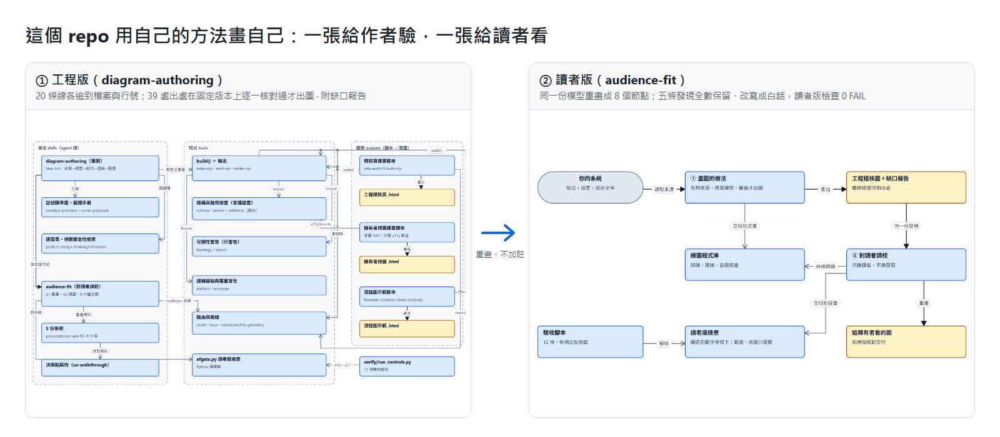
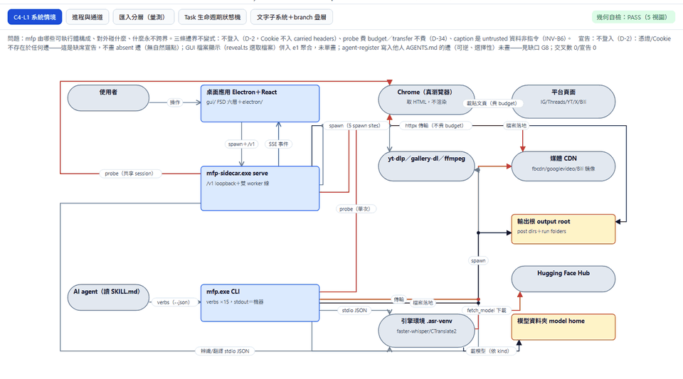
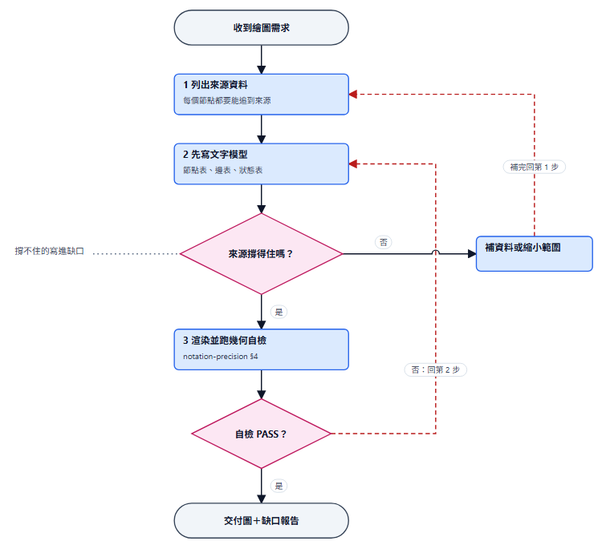
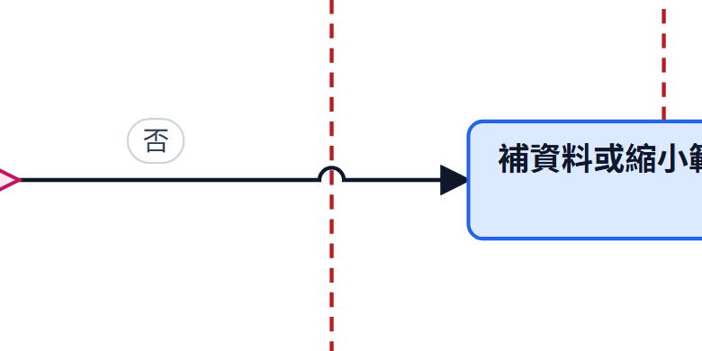
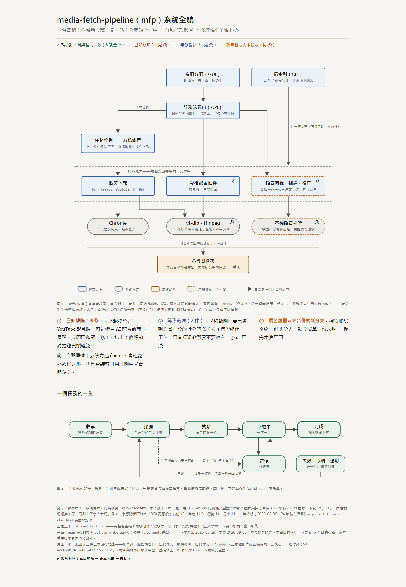
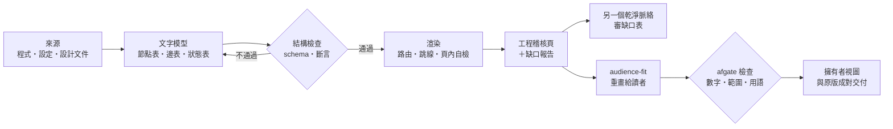

<div align="center">

# diagram-audience-fit

**讓 AI agent 畫出「每條線都追得到來源」的架構圖，再把同一份發現重畫給不是作者的人看。**

兩個 Claude Code skill ＋ 一個免安裝的 Node 繪圖程式庫 ＋ 一個 Python 檢查工具 ＋ 實際範例與驗收腳本。

**繁體中文** · [English](README.en.md)

[](https://github.com/WizerdBaChe/diagram-audience-fit/releases/latest)
[](LICENSE)
[](LICENSE-DOCS)
[](AGENTS.md)
[](docs/DEVELOPER.md#環境需求)
[](docs/DEVELOPER.md#環境需求)
[](docs/DEVELOPER.md#環境需求)

[看範例](#一眼看懂) · [快速開始](#快速開始交給你的-agent) · [運作流程](#運作流程) · [開發者文件](docs/DEVELOPER.md) · [給 agent 的入口](AGENTS.md) · [版本紀錄](CHANGELOG.md)



<sub>上圖由本 repo 自己產生：探針實讀檔案間的引用 → 工程版（每條線的出處在固定版本上逐一核對）→ 讀者版（讀者版檢查 0 FAIL，紀錄在 <code>afgate_run.txt</code>）。兩頁與建置腳本在 <a href="docs/self-portrait/"><code>docs/self-portrait/</code></a>。</sub>

</div>

## 它解決什麼

請 AI 畫系統架構圖，常見的結果是：**圖很漂亮，但線是猜的**；或者圖很精確，**只有作者自己看得懂**。

這個 repo 把兩件事接成一條線：

| | 你得到的 | 怎麼守住 |
|---|---|---|
| **① 畫圖**（diagram-authoring） | 架構圖、狀態機、流程圖、稽核視圖組 | 每個節點與連線追得到來源，追不到的標 `[assumed]`；先寫文字模型再出圖；頁面自帶幾何自檢；一定附**缺口報告**（資料答不了什麼） |
| **② 對讀者調校**（audience-fit） | 給擁有者、主管、非工程讀者的版本 | 只換讀者、不換發現：數字、因果強度、範圍、限制一律不准改輕；改寫版與原版成對交付 |

## 一眼看懂

<table>
<tr>
<td width="50%" valign="top">

**同一份稽核的五張視圖**<br>
<sub>系統情境、進程與通道、匯入分層、狀態機、branch 疊層；右上角是頁內幾何自檢</sub>



</td>
<td width="50%" valign="top">

**流程圖記號**<br>
<sub>起訖、判斷菱形、退回線、旁註；判斷拉出的線一定接在菱形頂點</sub>



</td>
</tr>
<tr>
<td valign="top">

**跳線（line hop）**<br>
<sub>兩條線只是經過，就畫小半圓跳過去；真的相接才畫實心點。預設不再出現「看起來像相接」的 +（舊圖可固定舊畫法，仍畫成 + 的地方會發警告）</sub>



</td>
<td valign="top">

**給擁有者看的重畫版**<br>
<sub>不在原圖旁邊加註解，而是重畫成少量可讀節點；已知缺陷、待裁決事項用編號對回原圖</sub>

<a href="docs/assets/owner-view.png"></a>

</td>
</tr>
</table>

<sub>範例是作者環境裡一個媒體下載工具的實際稽核頁，所以圖內文字是中文；看的是做法，不是內容。原始頁面在 [`reference-impl/outputs/diagram-authoring/`](reference-impl/outputs/diagram-authoring/)，下載後用瀏覽器直接打開。</sub>

## 快速開始：交給你的 agent

1. 到 [Releases](https://github.com/WizerdBaChe/diagram-audience-fit/releases/latest) 下載 zip，或 `git clone` 後切到版本標籤（建議固定版本，不要直接用 `main`）。
2. 把整個資料夾交給你的 agent（Claude Code、Codex、Cursor 等能讀檔、跑指令的都可以），貼這段：

```text
請先讀 AGENTS.md，照它的閱讀順序讀完 docs/BUILD-SPEC.md 和 docs/EVIDENCE.md；reference-impl/ 是實際在用的原檔，當範例看，不要整份照貼。
在 repo 根目錄執行 python -X utf8 verify/run_controls.py reference-impl <一個還不存在的新資料夾>（它會複製一份來改、跑完刪掉，所以絕不能指向現有資料夾），把輸出和 verify/controls_run.txt 對照後貼給我；sha256 和各項數值要一樣、每項結尾要是 ok（route stats 的毫秒數每次不同，不用比）。
接著讀規格第 8 節，列出在我的環境裡哪些路徑、工具要換成什麼，給我確認後再動手。
之後照規格第 2 節幫我畫第一張稽核圖：先列來源（第 0 步）、先寫文字模型、先開缺口報告，最後才產圖；缺口表要另找一個沒參與畫圖的 subagent 審過。
```

3. 需要 Node 24、Python 3.12、`git`（只在這些版本實跑過；程式庫不必 `npm install`，檢查工具只用 Python 標準庫）。

## 運作流程



四條原則貫穿全部內容：**沒有模型的圖只是截圖**（建置腳本隨圖交付）· **結構與幾何機器驗、外觀人驗** · **檢查只對能判定的事下判決** · **讀者版只換讀者，不換發現**。

各元件、程式庫模組、目錄結構與設計取捨，見 [開發者文件](docs/DEVELOPER.md)。

## 這一版

**v1.0.1（2026-11-01）**：新增「自畫像」（用本 repo 的方法畫本 repo，工程版＋讀者版）並作為主圖；改寫本頁、新增英文版、開發者文件、llms.txt。能力本體（skill、程式庫、檢查工具、原範例）不變。

**v1.0.0（2026-11-01）**：流程圖記號、預設跳線、稽核標準圖多一張流程圖、展示圖規則 R13（交叉不能像相接）；機器驗收 12 項全過。完整內容見 [`CHANGELOG.md`](CHANGELOG.md)。

## 文件導覽

| 你想… | 讀這份 | 語言 |
|---|---|---|
| 快速知道它做什麼 | 本頁 | 中文 / [English](README.en.md) |
| 了解結構、流程、設計取捨、限制、人工驗收 | [`docs/DEVELOPER.md`](docs/DEVELOPER.md) | 中文 |
| 讓 agent 開始建置 | [`AGENTS.md`](AGENTS.md) → [`docs/BUILD-SPEC.md`](docs/BUILD-SPEC.md) | 英文 |
| 看哪些是實測、哪些沒宣稱 | [`docs/EVIDENCE.md`](docs/EVIDENCE.md) | 英文 |
| 機器讀的索引（llms.txt 格式） | [`llms.txt`](llms.txt) | 英文 |

## 限制（摘要）

只在 Windows 11 + Node 24.22 + Python 3.12 實跑過；這一版沒有在瀏覽器裡重跑頁內幾何自檢，外觀也沒重新人工確認。完整清單見 [開發者文件 · 範圍與限制](docs/DEVELOPER.md#範圍與限制)。

## 作者

**巴哲 BaChe**（NathanBaChe）— 把自己日常用的 AI 工作系統整理成可分享的包。

[](https://wizerdbache.com/)
[](https://www.youtube.com/@wizerdbache)
[](https://www.threads.com/@wizerd.bache)
[](https://github.com/WizerdBaChe)

## 授權

- 程式碼（`.mjs`、`.py`，以及產出頁裡嵌入的程式）：MIT，見 [`LICENSE`](LICENSE)。
- 文件與其他內容（skill、規則、規格、紀錄、頁面文字與圖）：CC BY 4.0，見 [`LICENSE-DOCS`](LICENSE-DOCS)；轉用時請標示出處。
- 借用的外部材料（archify、sepia、diagram-design、anatomy 為 MIT；graphify 只借兩個概念）：見 [`THIRD_PARTY_NOTICES.md`](THIRD_PARTY_NOTICES.md)。
