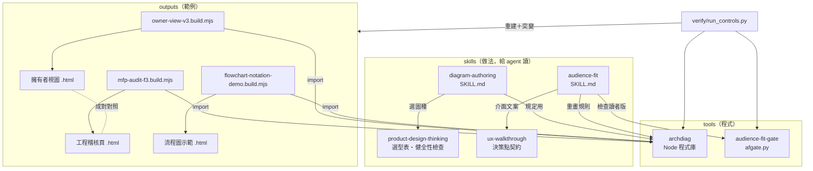
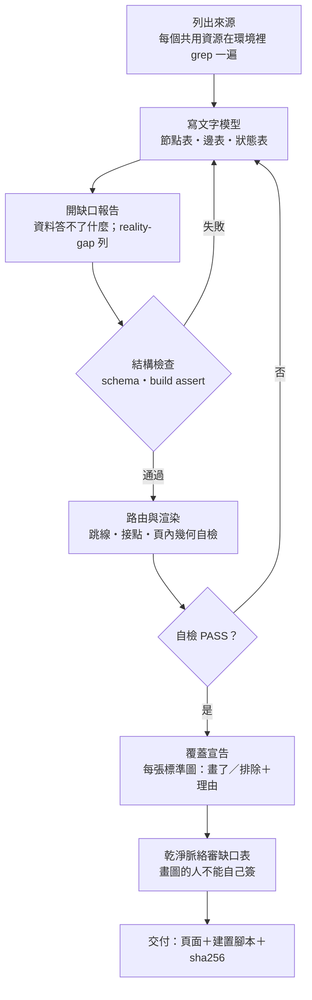

# 開發者文件 · diagram-audience-fit

給想看懂結構、改編或維護這個 repo 的人。宣傳與快速上手在 [`README.md`](../README.md)；agent 的建置入口是 [`AGENTS.md`](../AGENTS.md)，正式規格是 [`BUILD-SPEC.md`](BUILD-SPEC.md)（英文）。

**本頁目錄**：[目錄結構](#目錄結構) · [元件與呼叫關係](#元件與呼叫關係) · [畫圖流程](#畫圖流程) · [程式庫模組](#程式庫模組archdiag) · [環境需求](#環境需求) · [驗收怎麼跑](#驗收怎麼跑) · [設計上刻意的幾件事](#設計上刻意的幾件事改之前請先看) · [範圍與限制](#範圍與限制) · [人工驗收清單](#人工驗收清單) · [README 圖片怎麼重生](#readme-圖片怎麼重生)

## 目錄結構

```text
diagram-audience-fit/
├── README.md / README.en.md      宣傳與快速上手（中文／英文）
├── AGENTS.md                     agent 入口：閱讀順序、第一個指令、安裝對照表、改編規則
├── llms.txt                      機器讀的文件索引
├── CHANGELOG.md                  版本紀錄（版本 = git tag）
├── LICENSE / LICENSE-DOCS        程式碼 MIT／文件 CC BY 4.0
├── THIRD_PARTY_NOTICES.md        借用的外部材料與授權
├── docs/
│   ├── DEVELOPER.md              本頁
│   ├── BUILD-SPEC.md             規格（英文）：§0–§9，驗收表 A1–A16
│   ├── EVIDENCE.md               實測紀錄、規則出處、沒有宣稱的事
│   ├── self-portrait/            用本 repo 的方法畫本 repo：探針、工程版、讀者版（各附建置腳本）
│   └── assets/                   README 用圖＋重生腳本 build_assets.py
├── reference-impl/               原環境 ~/.claude 的實際原檔（逐位元組，宣告修改見規格 §9）
│   ├── skills/
│   │   ├── diagram-authoring/    畫圖的做法本體＋記號精準度、載體手冊
│   │   ├── audience-fit/         對讀者調校＋5 份參照
│   │   ├── product-design-thinking/references/   選型表、視圖健全性檢查
│   │   └── ux-walkthrough/references/            介面文案的決策點契約
│   ├── tools/
│   │   ├── archdiag/             Node 繪圖程式庫（免 npm install）
│   │   └── audience-fit-gate/    讀者版機械檢查（Python 標準庫）
│   ├── rules/                    證據、版面停手、交付文件、驗證等級
│   ├── references/design-axes/   跨媒材通則
│   └── outputs/
│       ├── diagram-authoring/    範例：工程稽核頁、擁有者視圖、流程圖示範（含建置腳本）
│       └── skill-reviews/        外部借用程式碼的來源分析
└── verify/
    ├── run_controls.py           機器驗收（每項同時跑會過／不會過兩種輸入）
    ├── controls_run.txt          我們這邊的執行紀錄（從乾淨 clone 跑）
    ├── list_unshipped.py         產生「沒附路徑」清單
    └── unshipped_paths.txt       原檔提到但沒附的 50 個路徑
```

## 元件與呼叫關係



## 畫圖流程

規格 §2 的簡化示意，只表達**順序**：先來源、再模型、再缺口，最後才是圖。步驟編號與完整內容以 [`BUILD-SPEC.md`](BUILD-SPEC.md) §2 與 `skills/diagram-authoring/SKILL.md` 為準（圖上不標號，避免和它們的 Step 編號混淆）。



## 程式庫模組（archdiag）

| 模組 | 做什麼 |
|---|---|
| `index.mjs` | `build()` 入口：模型 → 檢查 → 路由 → 輸出 |
| `schema.mjs` | 視圖模型的結構驗證（只判能判定的事） |
| `asserts.mjs` | 建置期斷言（例如判斷菱形的線必須接在頂點） |
| `route.mjs` | 正交連線路由與標籤（pill）擺放 |
| `hops.mjs` | 跳線與接點：只經過的交叉畫半圓，真相接畫實心點 |
| `topology.mjs` / `layout.mjs` | 拓撲與版面可讀性**警告**（不會讓建置失敗） |
| `tokens.mjs` | 樣式 token 表＋對比度檢查 |
| `emit.mjs` / `tables.mjs` | 輸出 SVG、頁面與節點／邊表 |
| `selfcheck.mjs` | 頁內幾何自檢（瀏覽器打開時執行） |
| `envelope.mjs` / `anchors.mjs` | 快照封套與證據錨點（每個元素對回來源） |
| `delta.mjs` | 兩版模型的差異 |
| `flow-selftest.mjs` | 流程圖與跳線的雙向校準 |
| `m1.mjs` | 收據回歸；需要原環境另一個元件，這裡跑不起來 |
| `vendor/archify-geometry.mjs` | 借用的幾何函式（MIT，見 THIRD_PARTY_NOTICES） |

## 環境需求

- **Node 24**（實跑 24.22.1）：程式庫只用內建模組，不必 `npm install`。
- **Python 3.12**（實跑 3.12.7）：`afgate.py` 與 `verify/` 只用標準庫。
- **git**：驗收 A15 會建一個暫時的 git repo。
- 只在 **Windows 11** 實跑過。
- 只有重生 README 圖片需要額外工具（見[最後一節](#readme-圖片怎麼重生)）。

## 驗收怎麼跑

```text
python -X utf8 verify/run_controls.py reference-impl <一個還不存在的新資料夾>
```

腳本把 `reference-impl/` 複製到那個資料夾、對副本做突變、跑完刪掉。每一項同時跑「該通過」與「該失敗」兩種輸入並印出兩邊的值，結尾 `-> ok` 才算過。和 [`verify/controls_run.txt`](../verify/controls_run.txt) 比對：sha256 與計數要一致，`route stats` 的毫秒數不用比。v1.0.0 的紀錄：A1–A5、A7、A10、A11、A13–A16 共 12 項全過。

## 設計上刻意的幾件事（改之前請先看）

1. **稽核以「實際在跑的環境」為來源，設計文件只是待核對的主張。** 每個共用資源，把它的路徑在環境裡 grep 一遍；找到但沒畫的讀者，各記一列 `reality-gap`。只照設計文件畫的稽核，只能證明文件自己吻合自己。
2. **覆蓋宣告**：標準視圖集的每一張、grep 找到的每一類入口，都要標「畫了」或「排除＋理由」。
3. **缺口表不由畫圖的人自己簽「沒缺口」**，要另一個乾淨脈絡的讀者重審。
4. **節點位置是輸入不是輸出**：位置有意義時一律顯式座標；程式只排連線。
5. **同樣的輸入產生同樣的位元組**，所以收據（sha256）有意義、能重生驗證。
6. **讀者版一定成對交付**：原版＋改寫＋放在同一視野的對照。單獨交改寫無法驗收。
7. **不重疊優先於少交叉**：路由器會為了讓線分開而多一些交叉，這是刻意的；剩下的交叉用跳線畫，讓它看起來不像相接。不要為了壓低交叉數把線併回去。
8. **可讀性只發警告**：排成一直線、線擠在同一段、「+」交叉這類問題，程式只警告、不讓建置失敗，因為「好不好讀」不是幾何算得出來的；會讓建置失敗的警告，最後會被關掉而不是被讀。

## 範圍與限制

- 只在 **Windows 11 + Node 24.22 + Python 3.12** 實跑過。
- 頁內幾何自檢（規格 A6）這次沒有在瀏覽器裡重跑；外觀也沒有為這一版重新人工確認，原頁當初的人工驗收只適用原頁。
- `tools/archdiag/m1.mjs` 需要原環境另一個元件（沒附），在這裡跑不起來。
- 已知弱點：模型裡有指向不存在節點的連線時，建置會失敗，但是先由路由器崩潰（`TypeError`），不是由結構檢查點名（規格 A3）。
- 原檔中提到的 50 個路徑**沒有附**（其他 skill、規則索引、審查紀錄、提案單、幾支別的檢查工具）；跑程式庫、檢查工具、範例都不需要它們。清單在 `verify/unshipped_paths.txt`。
- 文中的 hook、瀏覽器面板規則、決策紀錄、「使用者裁定」是原環境的機制，讀成「為什麼這樣設計」，不是你也得照做的規則。
- 範例是原環境某個產品（一個貼文媒體下載工具）的稽核頁，內容與你無關，看的是做法與重畫前後的取捨。
- 相對原檔的修改只有五類（其餘逐位元組相同）：外部交流對象的名稱與編號、一個 session 編號與本機分析頁路徑、原環境專案資料夾的磁碟根目錄改成 `<projects>`（工具類專案名與檔名保留）、家目錄路徑改成 `~/.claude`、研究專案的出處改寫成中性說法（日期與教訓編號保留）。逐條見規格第 9 節。

## 人工驗收清單

程式與測試證明不了的部分。

**A 必驗**
1. 在瀏覽器打開 `reference-impl/outputs/diagram-authoring/mfp-audit-f3.html`，切換各分頁：頁面上的幾何自檢報告 0 個問題，圖沒有被裁掉。這項和字型有關；若不是 0，先看是哪幾處、是不是字型較高造成的。
2. 同一頁上，兩條線交叉的地方是小半圓跳線，真的相接的地方才有實心圓點，沒有看起來像相接的「+」。
3. 工程原版和擁有者視圖（`mfp-audit-f3-owner-view-v3.html`）並排看：擁有者視圖沒有新增或刪掉任何發現，數字與限制對得上。
4. agent 依規格畫出的第一張稽核圖：缺口表有 `reviewer` 欄，而且審的人不是畫圖的那個 session。

**B 體驗**
5. 擁有者視圖在手機寬度下仍讀得懂（對照 `mfp-audit-f3-owner-view-v3.png`）。
6. 顏色換成灰階後，節點種類與連線種類仍分得出來（形狀＋顏色雙重編碼）。
7. `flowchart-notation-demo.html` 一頁看得懂每個流程圖記號的意思。

## 自畫像：用本 repo 的方法畫本 repo

[`docs/self-portrait/`](self-portrait/) 是 README 主圖的來源，也是這套做法的完整示範（照規格 §2 的順序）：

1. **來源**：`probe_refs.py` 實讀 `reference-impl/` 的 44 個文字檔，記下每一條檔案間的引用（匯入、路徑引用、skill 互相點名），寫成 `refs.json`。圖不是照資料夾結構猜的。
2. **工程版**：`self-audit.build.mjs` 的每條線都從 `refs.json` 查出處（查不到就建置失敗），再用 `anchors.mjs` 在固定 commit 上逐一核對檔案與行號；交叉超過 3 個時程式庫拒絕建置，所以版面重排過。頁內附缺口報告與覆蓋宣告。
3. **讀者版**：`self-owner-view.build.mjs` 由工程版的模型重畫成 8 個節點，附對照表與原樣保留的發現；用 `afgate.py` 對照原版檢查（第一輪抓到 3 處給讀者看的頁面寫了檔案路徑，已改）。

重生（repo 根目錄）：

```text
python -X utf8 docs/self-portrait/probe_refs.py
node docs/self-portrait/self-audit.build.mjs
node docs/self-portrait/self-owner-view.build.mjs
python -X utf8 reference-impl/tools/audience-fit-gate/afgate.py all docs/self-portrait/self-audit.html docs/self-portrait/self-owner-view.html
```

探針的限制寫在工程版的缺口報告（G3、G5）：它只認匯入、路徑字串與 4 個 skill 名稱，只在文字裡描述的依賴看不到。

## README 圖片怎麼重生

`docs/assets/` 的圖都由 [`docs/assets/build_assets.py`](assets/build_assets.py) 從 `reference-impl/outputs/diagram-authoring/` 的範例頁截出來，不是手工圖。需要 Python Playwright（含 Chromium）與 ffmpeg（只有 GIF 用到）：

```text
python -X utf8 docs/assets/build_assets.py
```

範例頁改了就重跑。圖片位元組會因字型渲染而不同，不宣稱可逐位元組重現；頁面本身才是可重現的。
